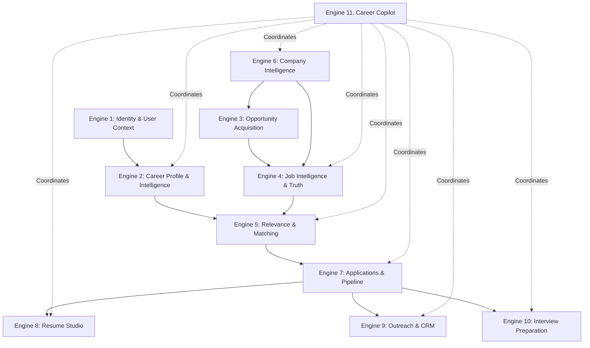

# HiresWay — Core Engine Architecture

## 1. System Philosophy & Architecture Principles
HiresWay is structured as a **modular monolith** running client-side with zero mandatory paid services, leveraging browser-native persistence (IndexedDB & LocalStorage), Web Workers, and deterministic career intelligence engines.

### Key Principles:
1. **One Canonical User Profile**: Stored in `profileRepository` and accessed via `ProfileContext` / `useProfile`.
2. **One Canonical Job Record**: Stored in `jobRepository` with deterministic deduplication by company, title, and location keys.
3. **One Canonical Company Record**: Stored in `targetCompanyStore` with domain resolution, multi-tier logo fetching, and ATS detection.
4. **One Persistent Application Record**: Stored in `applicationEngine` tracking user pipeline state, dates, notes, and interviews.
5. **Shared Business Logic**: Centralized in `src/core/` rather than duplicated in UI components.
6. **Zero-Cost Operation**: Deterministic heuristic models, client-side PDF/DOCX parsing (`pdfjs-dist`, `mammoth`), and local intent processing.

---

## 2. The 11 Core Engines

### Engine 1 — Identity, Access & User Context (`src/core/auth/userContext.ts`)
- **Responsibilities**: Session management, user ownership isolation, preference storage, authorization enforcement.
- **Inputs**: Credentials / local session token, user preferences.
- **Outputs**: Scoped `UserContext` with `userId`, `email`, permissions, and audit log.

### Engine 2 — Career Profile & Intelligence (`src/core/profile/`)
- **Responsibilities**: Resume parsing (PDF/DOCX/TXT), structured career profile normalization, skills and work history extraction.
- **Inputs**: Raw resume files, manual user edits.
- **Outputs**: Canonical `UserProfile` and `CareerProfile`.

### Engine 3 — Opportunity Acquisition & Job Discovery (`src/core/jobs/discoveryEngine.ts`)
- **Responsibilities**: Continuous multi-source querying across ATS platforms (Greenhouse, Lever, Ashby, Workable) and curated feeds.
- **Inputs**: Search configurations, prioritized target companies.
- **Outputs**: Raw job opportunities with source provenance and discovery run records.

### Engine 4 — Job Intelligence, Verification & Normalization (`src/core/jobs/jobRepository.ts`)
- **Responsibilities**: Canonical entity deduplication, salary normalization, remote classification, URL syntax verification and live probes.
- **Inputs**: Raw discovered listings, user-imported URLs.
- **Outputs**: Canonical `JobOpportunity` entities with verification status (`verified_live`, `needs_verification`).

### Engine 5 — Relevance, Matching & Ranking (`src/core/intelligence/careerIntelligenceEngine.ts`)
- **Responsibilities**: 4-factor weighted match analysis (40% Role/Skills, 30% Experience/Seniority, 20% Location/Remote, 10% Compensation/Growth), pre-feed threshold gating (score $\ge 40\%$), and match explanations.
- **Inputs**: Canonical `UserProfile`, Canonical `JobOpportunity`.
- **Outputs**: `JobMatchAnalysis` (overallScore, strengths, missingSkills, fitTier).

### Engine 6 — Company Intelligence & Target Companies (`src/core/target-companies/`)
- **Responsibilities**: Excel/CSV company bulk ingestion, domain resolution, fast ATS careers page discovery (`fastCareerPageEngine.ts`), multi-color logo resolution.
- **Inputs**: Company names, domains, spreadsheet files.
- **Outputs**: Canonical `TargetCompany` entities linked to discovery workers.

### Engine 7 — Applications & Job-Search Pipeline (`src/core/applications/applicationEngine.ts`)
- **Responsibilities**: Tracking applications across stages (`saved`, `applied`, `screening`, `interviewing`, `offer`, `rejected`), notes, follow-up dates, bidirectional synchronization with `jobRepository`.
- **Inputs**: Job ID, stage updates, notes.
- **Outputs**: Canonical `ApplicationRecord` entities, pipeline metrics.

### Engine 8 — Resume, Documents & Application Studio (`src/core/documents/documentEngine.ts`)
- **Responsibilities**: Generating job-tailored resume blueprints, cover letters, storing named document versions linked to jobs and applications.
- **Inputs**: Canonical profile, target job, template preferences.
- **Outputs**: Tailored resume variants, markdown exports, version history.

### Engine 9 — Outreach & Relationship Management (`src/core/outreach/outreachEngine.ts`)
- **Responsibilities**: Cold outreach and referral drafts, contact management, communication channel logs (LinkedIn InMail, Email), follow-up cadences.
- **Inputs**: Target job, company, recruiter/lead contact info.
- **Outputs**: Personalized outreach messages, scheduled follow-up alerts.

### Engine 10 — Interview Preparation & Career Growth (`src/core/interviews/interviewPrepEngine.ts`)
- **Responsibilities**: Role-specific STAR question mapping, behavioral briefs, debrief notes, career growth trajectory benchmarks.
- **Inputs**: Application context, target job description, profile milestones.
- **Outputs**: Role `InterviewBrief`, practice transcripts, growth gap analysis.

### Engine 11 — Career Copilot & Orchestration (`src/core/copilot/careerCopilotEngine.ts`)
- **Responsibilities**: Natural-language conversational interface with controlled tool registry executing real engine actions.
- **Inputs**: User prompts, natural-language commands.
- **Outputs**: Structured responses, engine tool invocation results, navigation deep-links.

---

## 3. Shared Infrastructure
- **Persistent Storage**: Layered LocalStorage + in-memory store (`persistentStorageEngine.ts`).
- **Notification Engine**: Shared follow-up reminders and discovery completion notifications.
- **Diagnostics Service**: Transparent error tracking and source health telemetry without logging private data.
