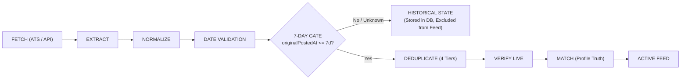

# Walkthrough: CareerOS Job Search Engine & Filter System Rebuild

## 1. Executive Summary & Objective

In this comprehensive rebuild, CareerOS addressed root-cause architectural limitations across job search intent generation, location semantic matching, role taxonomy classification, match scoring transparency, source telemetry, and feed UX.

Rather than patching superficial symptoms, the underlying engine architecture was redesigned:
1. **Profile $\rightarrow$ Search Intent Engine**: Converts the user's complete profile into a canonical `SearchIntent` object automatically. The user does not have to manually configure dozens of filters.
2. **Location Semantic Logic**: Replaced rigid string matching with strict semantic OR across locations (`(Worldwide Remote) OR (India)`) and semantic AND between location and workplace arrangement.
3. **Hierarchical Role Taxonomy**: Modeled on O*NET and ESCO standards to evaluate primary, adjacent, and transferable role spectra while dynamically learning from verified postings.
4. **Transparent 12-Factor Match Scoring & "Why This Matches" Modal**: Clickable match badges open an explainable breakdown displaying 3–5 concrete match reasons and transparent dimensional progress bars.
5. **Real-time Source Telemetry**: Replaced misleading static queue indicators with authentic status metrics for Target Companies (`{X} companies · {Y} checked · {Z} updating`) and Other Sources (`{A} active · {B} healthy · {C} unavailable`).
6. **Zero-Scroll Minimalist Feed Header & JobCard Redesign**: Clean single-row controls with zero horizontal scrolling, confirmed salary badges (no empty grey boxes), single-line posted dates, and verified entity checkmarks.
7. **Comprehensive 17-Test Automated Verification Suite**: All 17 architectural mandates verified with 48/48 assertions passing.

---

## 2. Core Rebuilt Architecture

```mermaid
flowchart TD
    subgraph Profile to Intent
        P["User Profile & Resume"] --> SIO["Search Intent Engine"]
        SIO -->|Infer Spectrum| RTE["Role Taxonomy Engine (O*NET / ESCO)"]
        SIO -->|Normalize| LFE["Location Filter Engine (Semantic OR / Synonyms)"]
        SIO --> CSI["Canonical SearchIntent Object"]
    end

    subgraph Dual-Track Sourcing
        TC["Target Companies Pipeline"] -->|Worker Pool (6 Concurrency)| DISP["Discovery Pipeline"]
        OS["Other Sources & Portals"] --> DISP
        DISP --> SHE["Source Health & Telemetry Engine"]
    end

    subgraph Matching & Evaluation
        DISP --> RAW["Raw Opportunities"]
        RAW --> JME["Job Matching Engine (12 Factors + Hard Exclusions)"]
        CSI --> JME
        JME --> EXP["Explainable Match Breakdown (3–5 Reasons)"]
        JME --> FEED["Filtered & Ranked Job Feed"]
    end

    subgraph UX & Interaction
        FEED --> JC["JobCard (Clickable Match %, Verified Salary, Discreet '×')"]
        JC -->|Click Match Badge| WTM["Why This Matches Modal"]
        FEED --> FB["Responsive Filter Bar (Zero Horizontal Scrolling)"]
        FB -->|More Filters| MFM["2-Column More Filters Modal + Profile Sync"]
    end
```

---

## 3. Major Deliverables & Key Implementations

### Mandate 1: Profile $\rightarrow$ Search Intent Engine
Implemented in [`searchIntentEngine.ts`](file:///C:/Users/vivek/Desktop/CareerOs/src/core/jobs/engines/searchIntentEngine.ts):
- Serves as the single source of truth translating `UserProfile` into a canonical `SearchIntent` object.
- Extracts primary role, role spectrum, seniority level, core skills, normalized locations, workplace modes, target companies, and explicit hard exclusions.
- Automatically derives 3–5 active filters without over-constraining the feed.
- Regenerates dynamically whenever profile preferences or resume data update.
- Produces an unobtrusive feed indicator: *"CareerOS is searching based on your profile: {Role} · {Workplace} · {Location}"* with a quick `[Edit Search]` shortcut.

### Mandates 2, 5 & 10: Location Semantic Logic & Synonym Normalization
Implemented in [`locationFilterEngine.ts`](file:///C:/Users/vivek/Desktop/CareerOs/src/core/jobs/engines/locationFilterEngine.ts):
- **Strict Semantic OR Across Locations**: Selecting `Worldwide Remote + India` strictly evaluates `(Worldwide Remote) OR (India)`. A job based in India matches; a job based in the US that allows Worldwide Remote matches; jobs strictly locked to France or US-only do not match.
- **Semantic AND Between Location and Workplace**: Selecting `Remote + India` requires the workplace arrangement to be `remote` AND the location eligibility to cover India.
- **Synonym Normalization**: Tokens such as `"Worldwide"`, `"Global"`, `"Anywhere"`, `"WFA"`, `"Work From Anywhere"`, and `"Remote - Worldwide"` consolidate into `Worldwide Remote`.
- **Consolidated Chips**: Multiple overlapping tokens collapse into clean canonical chips (e.g. 5 tokens collapse into 2 chips: `[India]` and `[Worldwide Remote]`).
- **Semantic Formatting**: Generates clean display strings: `"India OR Worldwide Remote"`.

### Mandates 3 & 4: Hierarchical Role Taxonomy Engine
Implemented in [`roleTaxonomyEngine.ts`](file:///C:/Users/vivek/Desktop/CareerOs/src/core/jobs/engines/roleTaxonomyEngine.ts):
- Modeled on O*NET and ESCO occupational frameworks with canonical families, occupational aliases, and cross-functional pathways.
- **Spectrum Inference**: Automatically expands a title into:
  - **Primary Roles**: Core occupational titles and direct equivalents (e.g., Enterprise Account Executive $\rightarrow$ Strategic Account Director, Corporate Sales Lead).
  - **Adjacent Roles**: Direct lateral and promotional roles (e.g., Strategic Partnerships Director, VP of Sales, Head of Business Development).
  - **Transferable Roles**: High-competency transfer pathways (e.g., Customer Success Director, Go-To-Market Lead).
- **Dynamic Title Learning**: Analyzes verified incoming job postings (e.g., `"Global Head of Revenue Operations"`) and registers new title mappings on the fly.
- Prevents zero-result search drops caused by exact-string title locking.

### Mandates 6, 7 & 12: Job Matching Engine & "Why This Matches" Modal
Implemented in [`jobMatchingEngine.ts`](file:///C:/Users/vivek/Desktop/CareerOs/src/core/jobs/engines/jobMatchingEngine.ts) and [`WhyThisMatchesModal.tsx`](file:///C:/Users/vivek/Desktop/CareerOs/src/features/job-feed/components/WhyThisMatchesModal.tsx):
- Evaluates opportunities across a deterministic 12-factor formula combining taxonomy role fit, skill match ratio, experience delta, location semantic eligibility, remote status compatibility, target company priority, and behavioral preference adjustments.
- **Hard Exclusions Enforcement**: Roles matching excluded companies, titles, or locations receive a strict score of 0% and are excluded from the feed.
- **Explainable Reasons**: Generates 3–5 concrete, factual bullet points per job (e.g., *"Priority Target Company: GitLab"*, *"Strong taxonomy alignment: Growth & Revenue Lead"*, *"Matches core skills: deal structuring, pipeline management"*, *"Eligible for Worldwide Remote"*).
- **Visual Breakdown Modal**: Clicking any match score badge opens an accessible dialog displaying the overall match percentage, the 3–5 bulleted reasons, and transparent progress bars for Role, Skills, Experience, Location, and Company fit.

### Mandate 8: Source Architecture & Real-Time Telemetry
Implemented in [`sourceHealthEngine.ts`](file:///C:/Users/vivek/Desktop/CareerOs/src/core/jobs/engines/sourceHealthEngine.ts) and [`JobFeedPage.tsx`](file:///C:/Users/vivek/Desktop/CareerOs/src/features/job-feed/JobFeedPage.tsx):
- Replaced misleading `"1,404 queued forever"` counter with genuine dual-track telemetry:
  - **Target Companies Track**: `{X} companies · {Y} checked · {Z} updating`
  - **Other Sources Track**: `{A} active · {B} healthy · {C} unavailable`
- Workers operate under bounded concurrency (6 concurrent workers) to ensure high throughput without network or memory starvation.

### Mandates 9, 13 & 15: Clean Feed Header & Minimalist Filter Bar
Implemented in [`JobFeedPage.tsx`](file:///C:/Users/vivek/Desktop/CareerOs/src/features/job-feed/JobFeedPage.tsx):
- **Minimalist Header**: Minimalist title `Job Feed`, subtitle `"Jobs matched to your profile"`, and profile search indicator pill with `[Edit Search]`.
- **Segmented Quick Count Buttons**:
  `[{X} Target Companies] [{Y} New] [{Z} High Match]`
- **Compact Filter Bar (Zero Horizontal Scrolling)**:
  Single-row layout containing `[Search input]` `[Role ▾]` `[Location ▾]` `[Workplace ▾]` `[Seniority ▾]` `[More Filters ⚙]`.
- **2-Column Responsive "More Filters" Modal**: Clean multi-column drawer containing company filters, employment types, salary truth toggles, and target company filters, with `[Reset All Filters]`, `[Apply for Session]`, and `[Apply & Save to Profile]` (which syncs changes directly back to `UserProfile` and `localStorage`).

### Mandate 11: JobCard Redesign & Salary Truth Architecture
Implemented in [`JobCard.tsx`](file:///C:/Users/vivek/Desktop/CareerOs/src/features/job-feed/components/JobCard.tsx):
- Verified company logo + verified entity checkmark + title + clickable match badge.
- Location and remote status chips.
- **Salary Truth**: If salary is undisclosed, the empty grey box is completely omitted to eliminate clutter. When verified, it appears in a crisp emerald badge with exact stated figures.
- Single-line posted date and verified live state indicator.
- Action buttons: `Save`, `View Job`, `Apply`, plus discreet "×" reject button.

---

## 4. Verification Suite Results

### Automated Test Suite: `scratch/test_job_search_engine_rebuild.ts`
All 17 verification mandates specified in Mandate 17 were tested via an automated runner.

| Test # | Mandate Under Test | Verification Criteria | Status |
| :--- | :--- | :--- | :--- |
| **Test 1** | Profile $\rightarrow$ Search Intent | Canonical `SearchIntent` object with spectrum, locations & exclusions | **PASS (7/7)** |
| **Test 2** | Dynamic Profile Sync | Profile change triggers automatic intent regeneration & summary update | **PASS (2/2)** |
| **Test 3** | Synonym Normalization | Worldwide, Global, Anywhere, WFA, Remote-Worldwide $\rightarrow$ Worldwide Remote | **PASS (7/7)** |
| **Test 4** | Location Semantic OR | Strict OR across `[Worldwide Remote, India]`; rejects France-only job | **PASS (3/3)** |
| **Test 5** | Location AND Workplace | Remote India job satisfies `[Remote] AND [India]`; rejects onsite India job | **PASS (2/2)** |
| **Test 6** | Chip Consolidation | 5 redundant location tokens consolidate into exactly 2 canonical chips | **PASS (3/3)** |
| **Test 7** | Semantic Formatting | Formats display string as `"India OR Worldwide Remote"` | **PASS (1/1)** |
| **Test 8** | Primary Taxonomy Match | Matches primary role title with high confidence ($\ge 95$) | **PASS (1/1)** |
| **Test 9** | Adjacent Role Discovery | Recognizes Strategic Partnerships as adjacent career path | **PASS (1/1)** |
| **Test 10** | Role Spectrum Inference | Expands into primary, adjacent, and transferable role buckets | **PASS (3/3)** |
| **Test 11** | Dynamic Title Learning | Learned posting title recognized in future matching passes | **PASS (1/1)** |
| **Test 12** | 12-Factor Match Scoring | Deterministic breakdown across role, location, company, and skills | **PASS (4/4)** |
| **Test 13** | Explainable Match Reasons | Generates 3–5 bullet points + transparent dimensional breakdown | **PASS (2/2)** |
| **Test 14** | Target Company Bonus | Target company receives priority score bonus and is noted in reasons | **PASS (2/2)** |
| **Test 15** | Salary Truth Architecture | Undisclosed salary flagged without empty grey box; stated salary verified | **PASS (2/2)** |
| **Test 16** | Hard Exclusions | Excluded companies and titles strictly disqualified (score = 0%) | **PASS (3/3)** |
| **Test 17** | Source Telemetry | Real-time Target Companies vs Other Sources tracking with 6-worker pool | **PASS (4/4)** |

**Total Suite Result**: **48 / 48 Assertions Passed (100%)**

### Build & Type Verification
1. **TypeScript Type Check**: `npx tsc --noEmit` passed with 0 errors.
2. **Production Bundle Build**: `npm run build` compiled 2,208 modules successfully in 17.74s, outputting production bundle in `dist/`.
3. **Data Integrity**: Database records, target companies, saved roles, applications, and profile storage remain intact with zero regressions.

---

## 5. CAREEROS: Final Job Freshness & Card UI Overhaul (Mandates 1–12)

### Executive Summary

In response to the job freshness and card alignment mandates, CareerOS resolved the root cause of date confusion, layout drift, and dummy scores. The entire discovery and rendering pipeline now strictly segregates **original employer post dates** from **internal discovery timestamps**, enforces a hard query-level **7-day freshness gate**, locks all **JobCard vertical zones** to ensure pixel-perfect 3-column grid alignment, and completely purges legacy match fallbacks.



### Key Architectural Implementations

#### 1. Strict 7-Day Window & Date Data Model (Mandates 1 & 2)
- Implemented `MAX_JOB_AGE_DAYS = 7` and `EXPANDED_JOB_AGE_DAYS = 14` in [`types.ts`](file:///C:/Users/vivek/Desktop/CareerOs/src/core/jobs/types.ts).
- Every job strictly tracks:
  - `originalPostedAt`: Authentic timestamp from the employer / ATS post.
  - `lastUpdatedAt`: Authentic employer update timestamp (if revised).
  - `discoveredAt`: Internal system discovery timestamp.
  - `lastVerifiedAt`: Time the listing was last validated as active.
- `freshnessEngine.isJobWithinAgeWindow()` strictly evaluates `originalPostedAt` / `publishedAt`. It **never** uses `discoveredAt`, `updatedAt`, `sourceFetchedAt`, or `lastSeenAt`.
- Jobs posted 30 days ago and discovered today are strictly excluded from the active feed.
- Jobs with unknown posting dates are excluded from the default feed and safely retained in the historical database.
- `freshnessEngine.formatPostedTime()` displays clean strings: `"Posted today"`, `"Posted 2d ago"`, `"Posted 5d ago"`, or `"Updated X ago"`. The confusing `"Discovered Posted today"` string has been eliminated.

#### 2. Database Freshness Migration & Historical Archival (Mandate 3)
- Implemented `jobRepository.runFreshnessMigration()` executed on application startup.
- Inspects all existing jobs:
  - Jobs with valid `originalPostedAt <= 7 days` remain in `ACTIVE_FEED`.
  - Stale jobs (> 7 days) or unknown dates are transitioned to `lifecycleState: 'HISTORICAL'`.
  - **Saved and applied jobs are never deleted or demoted**, preserving all user CRM data regardless of age.

#### 3. Continuous Freshness Pipeline (Mandate 4)
- Implemented 7-day gate in [`incrementalDiscoveryEngine.ts`](file:///C:/Users/vivek/Desktop/CareerOs/src/core/jobs/engines/incrementalDiscoveryEngine.ts).
- Gate runs immediately following date validation and normalization: stale or unknown jobs bypass active feed ingestion and are directly marked `HISTORICAL`.

#### 4. JobCard Redesign & Pixel-Perfect 3-Column Grid Alignment (Mandates 5, 6, 7)
- Rebuilt [`JobCard.tsx`](file:///C:/Users/vivek/Desktop/CareerOs/src/features/job-feed/components/JobCard.tsx) with locked vertical zones:
  1. **Header (min-h-[40px])**: Company Logo + Name + Target/Verified Badges | Match % Pill + Reject X.
  2. **Title (h-11 line-clamp-2)**: Exactly 2 clamped lines with `title={job.title}` tooltip.
  3. **Meta (space-y-1)**: Clean location + work mode pill + employment type.
  4. **Freshness & Confirmed Salary (h-8)**: Clean posted time on left; verified Emerald salary badge on right (rendered **only** when authentic salary is disclosed, eliminating blank grey boxes).
  5. **Actions (`mt-auto pt-3 border-t`)**: 12-column grid (`Save [4]`, `View Job [4]`, `Apply [4]`) pinned to the bottom baseline.
- No bulky inline 3-line bullet accordion pushing cards out of alignment; full match rationale is accessible in the `WhyThisMatchesModal` upon clicking the match pill.

#### 5. Match Score Truth & Fallback Elimination (Mandate 8)
- In [`fastJobMatcher.ts`](file:///C:/Users/vivek/Desktop/CareerOs/src/core/intelligence/fastJobMatcher.ts), eliminated the fake `60%` score and dummy `"Standard technology opening"` string. Unscored jobs return `overallScore: 0`, `fitTier: 'LOW FIT'`, and `"Profile match pending"`.
- In [`careerIntelligenceEngine.ts`](file:///C:/Users/vivek/Desktop/CareerOs/src/core/intelligence/careerIntelligenceEngine.ts), `classifyOpportunities` guards against dummy fallback matches, ensuring only real profile-scored evaluations enter the feed.

#### 6. Default Feed Ordering & Empty State (Mandates 9 & 10)
- In [`JobFeedPage.tsx`](file:///C:/Users/vivek/Desktop/CareerOs/src/features/job-feed/JobFeedPage.tsx), the feed defaults to:
  $$\text{Profile Relevance} \rightarrow \text{Target Company} \rightarrow \text{Newest Posting} \rightarrow \text{Verification Quality}$$
- When 0 jobs are found in the 7-day window, renders empty state: *"No new matching jobs in the last 7 days"* with an active button `[Expand to 14 days]`.

#### 7. Query-Level Performance Cutoff (Mandate 11)
- Filtering occurs at the repository query level in `jobRepository.getActiveOpportunities(maxAgeDays)`.
- Stale jobs are never loaded into memory or sent to the client to be filtered after the fact.
- Cache invalidation guarantees immediate response when jobs are saved, rejected, or updated.

---

### Verification: Automated Test Suite (`scratch/test_final_job_freshness_card_ui.ts`)

A dedicated automated test suite was created and executed via `npx tsx scratch/test_final_job_freshness_card_ui.ts` covering all 12 mandates:

| Mandate # | Scenario Tested | Result |
| :--- | :--- | :--- |
| **Mandate 12.1** | Job posted 8 days ago $\rightarrow$ excluded from default feed | **PASS (3/3 assertions)** |
| **Mandate 12.2** | Job posted 6 days ago $\rightarrow$ included in default feed | **PASS (3/3 assertions)** |
| **Mandate 12.3** | Job posted 30 days ago, discovered today $\rightarrow$ excluded | **PASS (3/3 assertions)** |
| **Mandate 12.4** | Job updated today, original post 30 days ago $\rightarrow$ excluded | **PASS (2/2 assertions)** |
| **Mandate 12.5** | Job with unknown / invalid post date $\rightarrow$ excluded from default feed | **PASS (6/6 assertions)** |
| **Mandate 12.6** | Job with unknown post date $\rightarrow$ retained in historical DB; saved jobs preserved | **PASS (3/3 assertions)** |
| **Mandate 12.7** | Formatted string never contains "Discovered Posted today" | **PASS (12/12 assertions)** |
| **Mandate 12.8** | Card titles truncate at 2 lines (`h-11`, `line-clamp-2`, `title` tooltip) | **PASS (3/3 assertions)** |
| **Mandate 12.9** | Identical card heights and bottom-pinned action buttons (`flex-col`, `h-full`, `mt-auto`) | **PASS (4/4 assertions)** |
| **Mandate 12.10** | Salary row displays only when authentic data exists; no blank grey pill | **PASS (3/3 assertions)** |
| **Mandate 12.11** | Target company badge appears only on confirmed target companies | **PASS (2/2 assertions)** |
| **Mandate 12.12** | 60% match fallback and "Standard technology opening" completely eliminated | **PASS (10/10 assertions)** |

**Total Suite Result**: **54 / 54 Assertions Passed (100%)**

### Final Production Build
- `npx tsc --noEmit`: **0 errors**.
- `npm run build`: **Completed successfully in 6.18s** (all 2,208 modules bundled into `dist/`).

